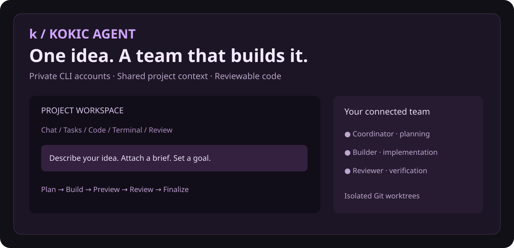
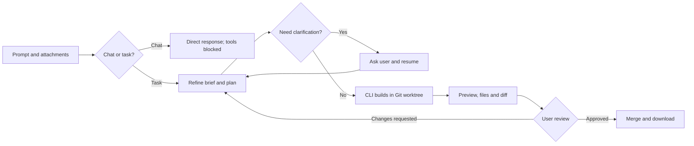
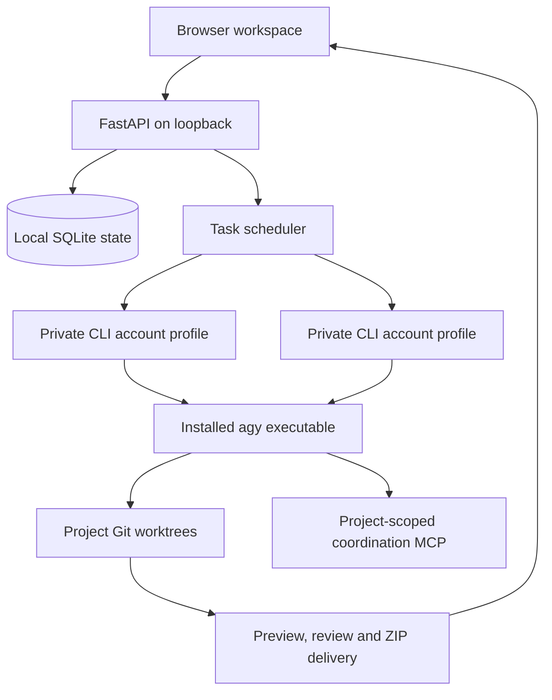

<div align="center">

# Kokic Agent

**Turn a conversation into code you can inspect, preview, and own.**




*A local agent studio powered by your installed Antigravity CLI.*

[Quick start](#quick-start) · [Features](#features) · [Architecture](#architecture) · [Security](#security-and-private-data) · [Contributing](CONTRIBUTING.md)

</div>

## What is Kokic Agent?

Kokic wraps your installed CLI in a project workspace with chat, account selection, editable code, live task output, and review tools. Each build runs in a Git worktree so you can inspect its changes before finalizing them. It uses the CLI's own authentication and available models; it does not include provider credentials or promise free access to paid models.

> This is an independent local project. It is not an official Google or Antigravity product. The banner above is a product illustration, not a live account screenshot.

## Features

| Area | Included |
| --- | --- |
| Project conversations | Separate chat threads, file attachments, contextual follow-up requests |
| Agent workflow | Intent classification, planning, clarification questions, implementation, review |
| Accounts and models | Isolated CLI profiles; per-account models and an apply-to-all option |
| Scheduling | Sequential work, parallel requests across available accounts, quota-triggered fallback |
| Live visibility | Task states, terminal output, native quota observations and reported reset times |
| Code ownership | Git branches and worktrees, file editor, diffs, review and merge |
| Delivery | Local website previews, supported document previews, artifact downloads, source ZIPs |
| Extensibility | Agent roles, goals, skills, rules, native plugins, MCP server definitions |
| Readable chat | Markdown formatting, source references, copy buttons, expandable reports |

## Quick start

### 1. Install prerequisites

Use Ubuntu Linux or Ubuntu on WSL2. Python **3.11 or newer**, Git, venv support, and D-Bus are required. Python 3.14 is the currently tested runtime. On Ubuntu:

```bash
sudo apt update
sudo apt install -y python3 python3-venv git dbus
python3 --version
```

Install Antigravity CLI separately using its vendor's instructions. Verify your installation:

```bash
command -v agy
agy --version
```

Kokic looks for `~/.local/bin/agy`. If your executable is elsewhere, set its absolute path:

```bash
export KOKIC_AGY="$(command -v agy)"
```

### 2. Clone and create your portal login

```bash
git clone https://github.com/vikrant-project/kokic-agent.git
cd kokic-agent
bash start.sh --setup
```

The launcher creates a virtual environment and installs locked Python dependencies. Enter **your own new portal email and password** when prompted. The password must have at least ten characters.

**Documentation-only example:** `developer@example.com` / `Example-Only-Change-Me!42`. These are fictional values, not an existing login. No default account is shipped.

### 3. Start the workspace

```bash
bash start.sh
```

Open **http://127.0.0.1:8787** and sign in with the portal credentials you just created.

For Windows PowerShell with an Ubuntu WSL distribution:

```powershell
.\start.ps1 -Setup
.\start.ps1
```

Choose a different port with `bash start.sh --port 8790` or `.\start.ps1 -Port 8790`.

### 4. Connect a CLI account

1. Open **Accounts → Sign in**.
2. Open the Google authorization link supplied by the native CLI.
3. Complete sign-in and paste the returned authorization code or callback URL into Kokic.
4. Wait until the account is marked **Connected**, then close its terminal.
5. Sync the model catalog and choose an available model.

Portal authentication and provider authentication are separate. Browser sign-in alone does not complete the CLI callback. Model availability depends on your account and installed CLI.

### 5. Build and review

Create a project, send a prompt, and optionally attach a brief. Answer any clarification questions. Follow execution in **Tasks** and **Terminal**, inspect files in **Code**, then use **Review & files** for previews and downloads. Approve the result to merge it into the project's main branch.

## Workflow



Sequential mode serializes top-level tasks within a project. Parallel mode allows available accounts to work on separate requests. Available-account scheduling can retry on another account after an actual quota-exhaustion signal. Only one worker or interactive terminal uses an account at a time. Delegation is agent-driven and requires other connected accounts; a prompt does not automatically run on every account.

## Architecture



The frontend uses plain JavaScript and CSS with a vendored xterm.js terminal. The backend manages PTYs, native CLI output, account profiles, encrypted configuration, and Git operations. No separate frontend build step is required.

## Configuration

| Setting | Default | Purpose |
| --- | --- | --- |
| `KOKIC_HOME` | `~/Kokic Agent` | Private database, encryption keys, profiles and generated projects |
| `KOKIC_AGY` | `~/.local/bin/agy` | Installed CLI executable |
| `--port` | `8787` | Local HTTP listener port |
| Project execution mode | Autonomous | Native CLI tools execute without approval prompts |

New projects use autonomous execution. You can select **Review command permissions** in project settings to restrict execution, although native headless commands that require interactive approval can then be denied. Chat/planning turns use a separate tool-blocking guard. Worktrees organize changes; they are not operating-system sandboxes.

## Quotas and integrations

Quota data is parsed from the native CLI's `/usage` output. Idle accounts refresh approximately every five minutes. Weekly and five-hour values are shown only when the CLI reports recognizable data. Missing data remains unknown; Kokic never invents a remaining percentage. Provider limits, cooldowns, model access, and output formats can change.

Add compatible MCP and connector definitions in Integrations. Authentication with third-party services must still be completed separately. Skills and rules are deployed into the selected account's private profile before a task starts. Plugin installation uses the installed CLI's native flow. Configured integrations are not a guarantee that every external service is connected or healthy.

## Security and private data

- The server binds to **127.0.0.1**. This release is intended for a trusted local operator, not a publicly exposed multi-tenant deployment.
- Autonomous tasks can execute commands with the Linux user's permissions. Review agent instructions and integrations before running work.
- Provider credentials, encrypted profiles, databases, master keys, sessions, uploaded files, and generated projects belong in the private runtime directory, never in Git.
- Portal passwords use scrypt hashing; integration secrets and private credential storage use encryption at rest. Back up runtime data together with its keys.
- API access is scoped to the signed-in user. Preview URLs are temporary bearer capabilities: anyone who has a valid URL can access that preview until expiry.
- Source downloads exclude common secret paths and dependency directories. Review generated code before sharing; exclusion rules cannot identify every possible embedded secret.
- This project has not undergone a production security audit. See [SECURITY.md](SECURITY.md).

The public repository contains application source and synthetic documentation assets only. It ships no working passwords, provider sessions, tokens, personal account screenshots, or example private projects.

## Development and checks

```bash
python3 -m venv .venv
source .venv/bin/activate
pip install -r requirements-dev.txt
python -m unittest discover -s tests -q
```

With Node.js installed, also run:

```bash
node tests/test_markdown.cjs
node --check web/app.js
node --check web/markdown.js
```

Tests cover authorization boundaries, attachment ownership, preview leases, path handling, quota parsing, Git review workflows, headless permission failures, and chat rendering. Unit tests use isolated temporary state; live provider access is separate.

## Troubleshooting

| Symptom | What to check |
| --- | --- |
| Sign-in still waiting | Paste the CLI callback code, not just the Google sign-in confirmation |
| Task stays queued | Connect an account, close its terminal, check quota and project pause state |
| Headless command denied | Check the project's execution mode and CLI permission support |
| Quota says unknown | Native CLI may not report a recognized format; inspect account usage output |
| Preview unavailable | A website task must produce a real `index.html` in its preview directory |
| Already running | Stop the existing server for the same `KOKIC_HOME` before restarting |

## Project status and credits

Kokic Agent is an evolving local workspace. Native CLI compatibility, integration behavior, and model availability depend on external software. It does not build every application format automatically or deploy websites to public hosting by default.

Terminal rendering uses [xterm.js](https://github.com/xtermjs/xterm.js); its license is included in `web/vendor/LICENSE-xterm.txt`. Third-party Python packages retain their respective licenses. No license grant for the original Kokic source is asserted by this README; a project license has not yet been selected.
